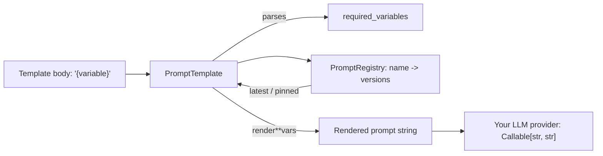

<p align="center">
  
</p>

<h1 align="center">Prompt Template Manager</h1>

<p align="center">
  <strong>Versioned, validated prompt templates with variable rendering — in Python.</strong><br>
  Define <code>{variable}</code> templates, register multiple versions, fetch latest or pinned, and render with strict validation.
</p>

<p align="center">
  <em>Built and maintained by <a href="https://viprasol.com">Viprasol Tech</a> — Fintech Experts. Full-Stack Builders.</em>
</p>

<p align="center">
  <a href="https://github.com/Viprasol-Tech/prompt-template-manager/actions/workflows/ci.yml"></a>
  <a href="LICENSE"></a>
  
  <a href="https://t.me/viprasol_help"></a>
  <a href="https://github.com/Viprasol-Tech/prompt-template-manager/stargazers"></a>
</p>

---

> **Provider-agnostic & offline.** This library manages and renders the *text* of your prompts — it never calls a model itself. Plug the rendered string into any LLM client (OpenAI, Anthropic, a local model, your own `Callable[[str], str]`). The whole library, demo, and test suite run with **no network and no API keys**.

> *Not production-hardened — review before use in critical systems.*

## Features

- **`{variable}` templates** — required variables are parsed straight from the body; literal braces via `{{` / `}}`.
- **Strict rendering** — `render(**vars)` raises `MissingVariableError` listing exactly what's absent; extra vars are ignored.
- **Versioning built in** — register many versions of a named template; fetch the latest or pin a specific version.
- **Immutable & validated** — templates are frozen pydantic models; malformed braces are rejected at construction time.
- **Zero model dependencies** — pure Python + pydantic; bring your own LLM client.
- **CLI** — `prompt-template-manager demo` registers, lists, and renders versioned templates offline.
- **Modern tooling** — ruff, mypy (strict), pytest, GitHub Actions CI.

## Quickstart

```bash
git clone https://github.com/Viprasol-Tech/prompt-template-manager.git
cd prompt-template-manager
python -m pip install -e ".[dev]"

# Register versioned templates and render the latest, fully offline:
prompt-template-manager demo
```

## Usage — render, version, then plug into a real provider

```python
from prompt_template_manager import PromptRegistry, PromptTemplate

registry = PromptRegistry()
registry.register(PromptTemplate(name="summarize", version=1, body="Summarize:\n{text}"))
registry.register(
    PromptTemplate(
        name="summarize",
        version=2,
        body="Summarize the following {style} text in {sentences} sentences:\n\n{text}",
    )
)

template = registry.latest("summarize")  # -> version 2
print(template.required_variables)  # ['sentences', 'style', 'text']

prompt = template.render(style="technical", sentences=3, text="...")


# The library stops at the rendered string. Hand it to ANY model client:
def my_llm(prompt: str) -> str:  # Callable[[str], str]
    ...  # openai / anthropic / local / fake
    return "..."


answer = my_llm(prompt)

# Pin an exact version for reproducibility:
v1 = registry.get("summarize", version=1)
```

## Architecture



## Roadmap

- [x] `{variable}` parsing, escaped braces, strict render validation
- [x] Versioned registry: latest + pinned fetch, list versions
- [ ] Load/save templates from YAML/JSON files
- [ ] Partial rendering and default values
- [ ] Jinja-style filters and conditionals

## Contributing

PRs welcome — see [CONTRIBUTING.md](CONTRIBUTING.md) and our [Code of Conduct](CODE_OF_CONDUCT.md).

## Contact — Viprasol Tech Private Limited

- Website: [viprasol.com](https://viprasol.com)
- Email: [support@viprasol.com](mailto:support@viprasol.com)
- Telegram: [t.me/viprasol_help](https://t.me/viprasol_help) | WhatsApp: +91 96336 52112
- GitHub: [@Viprasol-Tech](https://github.com/Viprasol-Tech) | [LinkedIn](https://www.linkedin.com/in/viprasol/) | X [@viprasol](https://twitter.com/viprasol)

## License

[MIT](LICENSE) (c) 2025 Viprasol Tech Private Limited
